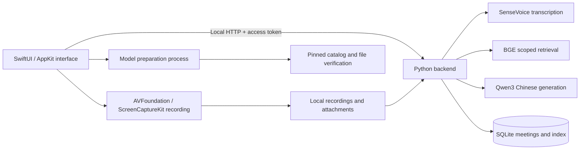

# Zhihui · 知会

[简体中文](README.md) · English

**Turn a conversation into knowledge you can revisit, edit, and ask questions about.**

A native macOS meeting assistant built for Chinese: record audio, transcribe multilingual meetings, display local multilingual captions and a presentation window, write Markdown notes, generate Chinese summaries, and ask questions with source citations—all using local inference. SwiftUI provides the desktop interface; SenseVoice, BGE, and Qwen3 provide the AI capabilities.

`macOS 14+` · `Apple Silicon` · `SwiftUI + Metal` · `Python 3.12` · `Local inference`

[Releases](https://github.com/zhutyler21/zhihui/releases) · [Quick start](#quick-start) · [Using Zhihui](#using-zhihui) · [Models and data](#models-and-data) · [Development and validation](#development-and-validation) · [Contributor guide](AGENTS.md)

Latest release: **0.8.0 / build 21**, including in-app updates, compact recording controls, transcript/notes panes, direct note editing and automatic meeting names. Source: [zhutyler21/zhihui](https://github.com/zhutyler21/zhihui). The standalone DMG includes Python, the backend, pinned dependencies, and the audio converter inside the App. You can move the App without retaining the source repository or installing Homebrew. Download the three models explicitly during first-run setup. Public releases use **ad-hoc signing and have not been notarized by Apple**. Local development builds can use an existing Apple Development identity to keep a compatible identity across updates. Set `ZHIHUI_SIGNING_IDENTITY` for the build or store its name or SHA-1 in the untracked `work/local-signing-identity`; an explicit identity takes priority, and unavailable configured certificates fail the build. This is neither Developer ID distribution signing nor notarization. See [release, signing, and installation details](docs/发布与安装.md) and [0.8.0 release validation](docs/0.8.0发布验收.md) (Chinese).

The current application interface is Chinese. This file provides English documentation; Chinese button labels are included where needed.

## Features

| Feature | What you can do |
| --- | --- |
| Meeting management | Create, search, and rename meetings; organize transcripts, notes, summaries, and attachments by meeting |
| Multilingual transcription | Record microphone audio, system audio, or both; import existing audio; retain timestamps and edit transcript segments |
| Cantonese transcription | Select Cantonese (`粤语`) under the speech-language setting; translations can stay disabled while originals and Chinese minutes remain available, with no extra model |
| Local live translation | Chinese, English, Japanese, and Korean; multiple selected targets, aligned originals and translations, retry, and multilingual export |
| Live translation display | A separate window with the original and up to four translation columns; external-display fullscreen, font size, light/dark appearance, pause, and follow controls |
| Markdown notes | Edit Markdown source and render headings, lists, tasks, quotes, tables, and code blocks when finished |
| Chinese summaries | Summarize the meeting's transcript, notes, and linked materials, with citations to the source text |
| Local knowledge base | Copy documents locally, extract text, split it into chunks, and build a Chinese vector index |
| Scoped questions | Search the entire knowledge base, all meetings, or one specific meeting; inspect the evidence behind answers |
| Recoverable deletion | Restore individual transcript segments within their meeting; restore meetings and documents from the sidebar Trash |
| Existing-record import | Import compatible Foresight meetings and attachments through a read-only process with duplicate prevention |

The interface uses native sidebars, split views, toolbars, and tables, with sea-salt blue, soft white, and teal accents. Body text uses a 16-point baseline. The moon/sun button at the top right switches directly between dark and light mode; appearance settings in the application menu still offer Follow System. The welcome screen uses SwiftUI and Metal for interactive glass refraction.

## Quick start

### 1. Download and install

| Requirement | Details |
| --- | --- |
| Hardware | Apple Silicon Mac; the release targets `arm64` |
| Operating system | macOS 14 or later |
| Runtime | Included in the App; no separate Python, ffmpeg, or Homebrew installation |
| Storage and network | Approximately 2.61 GB for models, plus the App, recordings, and attachments; first-time model downloads require internet access |

1. Download `Zhihui-v0.8.0-macOS-arm64.dmg` from the [v0.8.0 Release](https://github.com/zhutyler21/zhihui/releases/tag/v0.8.0).
2. Open the DMG and drag **Zhihui** (`知会`) into its **Applications** folder.
3. Open the installed App and follow macOS prompts for first-time opening and audio access.

The App reads its runtime from its current location. Moving the App does not require rebuilding it. Meeting data and models remain in your user data directory rather than moving with the App. See [release and installation details](docs/发布与安装.md) for downloadable files and checksum verification.

### 2. Complete first-run setup

Proceed from the welcome screen:

1. Follow macOS prompts to allow microphone and system audio access.
2. Select **Download required models** (`下载所需模型`). Existing files are checked offline and reused.
3. Follow the actual byte progress. Pause a download and select **Continue downloading** (`继续下载`) to resume later.
4. Once both audio permissions and all three models are ready, select **Enter Zhihui** (`进入知会`). The App checks models and permissions again before entry.

Models are stored at `~/Library/Application Support/知会/models/`, outside the App bundle. When the project installer upgrades an existing local development installation, it verifies and copies reusable models against the pinned catalog. Original model files remain in place; upgrading does not force another full download.

macOS groups system audio access under Screen & System Audio Recording. The current recorder receives and saves audio, not screen images. The App does not automatically reset system permissions. Once all three models are ready, everyday transcription, retrieval, and generation can run offline.

## Using Zhihui

### From recording to meeting notes

Meetings open in the materials page with one **Start recording** (`开始录音`) and **Import audio** (`导入音频`) group at the top. Click the recording button to start, or its adjacent arrow to choose the audio source. Empty states show guidance without duplicating these actions. A labeled **New meeting** (`新建会议`) button stays at the top right in every destination. Transcripts and notes share resizable panes by default: side by side in a wide window, stacked in a narrow window. Use the split icon beside the content tabs to turn off the split view and focus on one tab. **Live workspace** (`实时会场`) contains translation and display controls; returning preserves the content tab and note draft. Notes are saved before leaving, and a failed save keeps the current page open. The translation display remains an independent window.

1. **Create and name a meeting.** Select **New meeting** at the top right, then click the title to name it manually, or let minutes generation name it automatically.
2. **Choose an audio source.** Open the arrow beside **Start recording**. Use the microphone for an in-person meeting, system audio for content played on the Mac, or mixed audio for an online meeting with headphones.
3. **Record or import audio** directly from the meeting page. While recording, a persistent bar above the content shows the timer, **Stop recording** (`停止录音`), and **Stop and summarize** (`停止并整理`), including in Library and Questions. Stopping saves audio and continues transcription; summarizing waits for this meeting's remaining transcription.
4. **Take notes alongside the transcript.** Use a segment's “…” menu to edit or delete it. Write Markdown directly in empty notes, or click existing notes to resume writing. Changes save automatically; click outside the notes area or press ⌘Return to display the formatted result.
5. **Generate a Chinese summary.** Check names, numbers, decisions, owners, and deadlines against the cited source text. Meetings without a saved manual name receive a topic title from the minutes; regenerating minutes also refreshes automatic titles. Manual names remain unchanged. A naming failure keeps the existing name and still saves valid minutes.

Use **Language settings** (`语言设置…`) in the **Live translation** (`实时翻译`) area of the live workspace, choose source and target languages, then turn on the adjacent switch. Live mode saves approximately 2–6-second blocks before inference, plus queue, inference, and refresh latency; mixed audio adds approximately two seconds of timeline buffering. Translate existing text separately or select **Stop and summarize** (`停止并整理`) to finish this meeting's pending transcription before generating Chinese minutes. Numeric and common relative-time checks reject detected mismatches. See the [model architecture and research notes](docs/多语言实时翻译与模型体系.md) (Chinese).

For Cantonese meetings, select **Speech language → Cantonese** (`讲话语言 → 粤语`) before recording or importing audio. Speech recognition still uses Cantonese when translations are disabled. Automatic detection also recognized the single synthetic Cantonese fixture used in this check; this does not establish accuracy across accents. Originals may retain colloquial Cantonese wording, while minutes use Simplified Chinese. See the [Cantonese validation record](docs/粤语转写验收记录.md) (Chinese).

### Live translation on a conference display

In **Language settings** (`语言设置…`) in the live workspace's translation area, select the speech language, check the required Chinese, English, Japanese, and Korean targets, enable translation, and save. Cantonese is also available as an input language. Select **Open translation display** (`打开翻译大屏`) in the same area, move the separate window to an external display or projector, and select **Fullscreen** (`全屏`); Esc exits fullscreen. Recording and meeting editing stay in the main window.

The display puts the newest speech at the top, with originals and translations aligned by segment and updated as each translation completes. Follow mode returns to the top automatically. The meeting transcript keeps chronological order, with the newest content at the bottom. Hide the original, adjust captions from 24 to 64 points, switch light/dark appearance, pause display updates, or disable follow mode and scroll down to review earlier content. Pausing the display does not stop recording or translation. **Fill translations** (`补齐译文`) retries missing or failed targets. The display contains the latest 30 segments; full originals, translations, and minutes remain saved with the meeting.

Targets share one local text model and are generated in sequence, so additional targets can increase waiting time. Long speech or smaller windows can require scrolling or smaller text. This version provides a local native window for an attached display; LAN browser links and cross-device synchronization are not implemented. Moving the window and using fullscreen were checked on this Mac’s connected external display; other display hardware and long-running conference stability remain unverified. See the [live display validation record](docs/实时翻译大屏验收记录.md) (Chinese).

Mixed recording does not provide acoustic echo cancellation. Headphones help prevent speaker playback from being recorded again by the microphone.

### Ask questions about one meeting

Add relevant files in the meeting's **Attachments** (`附件`) tab, then select **Ask this meeting** (`问这场会议`). Alternatively, choose a specific meeting, all meetings, or the entire knowledge base in the question view. Changing the retrieval scope clears the current conversation. Expand answer citations to inspect their source text.

Supported documents include TXT, MD, CSV, JSON, LOG, HTML, text-based PDF, DOCX, PPTX, and XLSX. The App saves a local copy before extracting and indexing text; the original file is unchanged. Scanned PDFs are flagged as requiring OCR. Failed extraction remains visible rather than being reported as a completed index. The single-file limit is 256 MB; Office extraction and text length have additional limits defined in [documents.py](backend/documents.py).

### Delete and restore

- **Transcript segments:** the transcript view shows the meeting's original text. **Deleted segments** (`已删除片段`) in the upper-right opens a separate panel for that meeting. Restored segments return to their original time position.
- **Meetings and documents:** **Trash** (`回收站`) at the bottom of the sidebar manages whole meetings and documents. Deleted content is excluded from normal retrieval.
- **Foresight records:** **Import Foresight meetings** (`导入 Foresight 会议`) reads compatible records while retaining the original database. Email and contacts are not imported automatically.

## In-app updates

Starting with 0.8.0, standalone builds check GitHub daily. Use **Zhihui → Check for Updates…** (shown in Chinese) or **Settings → Software Updates** to check manually. Confirm download and installation to save notes, quit normally and relaunch. Active recording, model downloads and meeting jobs defer updates. If recording starts during a download, finish the task and choose **Install Update and Restart** in Settings. Automatic checks can be disabled; manual checks remain available.

Updates replace the App while keeping meetings, recordings and models in the existing user data directory. Requests fetch only release metadata and update packages; meeting content is never uploaded. Both feeds and archives require Ed25519 signatures. Sound permission retention also depends on bundle identity, compatible code signing and macOS; the updater never resets or bypasses permissions.

**The 0.5.0 release has no updater and requires one manual upgrade to 0.8.0.** Maintainers must publish the signed archive and `appcast.xml` together in a stable GitHub Release. Pushing source commits alone does not distribute an update. Source development packages disable release updates. See [update publishing instructions](docs/自动更新与发布.md) (Chinese).

## Models and data

### Three local models

| Purpose | Model | Runtime | Folder within the model directory |
| --- | --- | --- | --- |
| Mandarin, Cantonese, English, Japanese, Korean transcription | SenseVoice int8 + Silero VAD | sherpa-onnx / CPU | `sensevoice/` |
| Chinese semantic retrieval | BGE-small-zh-v1.5 | FastEmbed / ONNX Runtime / CPU | `bge-small-zh/` |
| Four-language translation, Chinese summaries and answers | Qwen3-4B-Instruct-2507 4bit | MLX / Apple Silicon GPU | `qwen3-4b/` |

The standalone model directory is `~/Library/Application Support/知会/models/`. Source-development mode defaults to the repository's `models/` directory.

[ModelCatalog.json](Resources/ModelCatalog.json) pins download sources, revisions, file sizes, and SHA-256 checksums. It currently contains 23 files totaling **2,614,496,485 bytes**, approximately 2.61 GB. Once prepared, transcription, retrieval, and generation use local files without cloud AI calls.

“Models ready” means the files passed verification. The first task still needs to load its model. File readiness, successful inference, and output quality are separate validation concerns.

### File locations

| Content | Default location |
| --- | --- |
| Source and development environment | This repository; `.venv/` and development `models/` |
| Installed App | `/Applications/知会.app` when dragged from the DMG; `~/Applications/知会.app` with the project installer |
| Standalone runtime | `知会.app/Contents/Resources/Runtime/`, resolved from the current App location |
| Standalone models and caches | `~/Library/Application Support/知会/models/` |
| Meeting database | `~/Library/Application Support/知会/database.sqlite` |
| Recordings and attachment copies | `recordings/` and `attachments/` within the same data directory |
| Setup completion record | `onboarding.json` within the same data directory |
| Backend log and access token | `backend.log` and `api-token` within the same data directory |
| Development evidence and previous App backups | Repository `work/`, separate from everyday meeting data |

The default backend listens only on `127.0.0.1:8768` and uses a random access token specific to its data directory. Directory permissions are 0700; token permissions are 0600. Data is stored in ordinary local files; application-level database encryption is not implemented. To back up meetings, quit the App and copy the **entire data directory**, including recordings, attachments, and the database.

## How it works



The setup screen invokes a separate model preparation process without starting the meeting backend. The main interface connects to the local service after setup. Retrieval filters by document scope and deletion state before ranking results; answers use retrieved source evidence and display citations.

### Repository layout

```text
.
├── AGENTS.md                 # Development rules and validation requirements
├── README.md                 # Chinese project documentation
├── README.en.md              # English project documentation
├── LICENSE                   # MIT project license
├── Sources/                  # SwiftUI interface, recording, state, and backend lifecycle
├── backend/                  # Extraction, SQLite, indexing, inference, and HTTP service
├── Resources/                # Metal shader, pinned model catalog, and runtime configuration
├── scripts/                  # Build, installation, model preparation, and validation
├── tests/                    # Python and native Swift regression checks
├── docs/                     # Design, interfaces, validation records, and third-party licenses
├── requirements.lock         # Pinned Python dependencies
├── .venv/                    # Local environment; excluded from Git
├── models/                   # Source-development models and caches; excluded from Git
├── dist/                     # Built App; excluded from Git
└── work/                     # Isolated validation artifacts; excluded from Git
```

## Development and validation

Read [AGENTS.md](AGENTS.md) before making changes. Some validation scripts and tests contain fixed-path guards for the development machine. When porting them, first establish a separate test root, then adapt the path checks while retaining isolation from everyday data.

### Build the standalone release from source

Development requires Apple Silicon, Xcode with command-line tools, the Apple Metal Toolchain, CMake 3.25 or later, and `uv`. The release runtime uses managed **CPython 3.12.11** and [requirements.lock](requirements.lock); see [StandaloneRuntime.json](Resources/StandaloneRuntime.json) for pinned runtime inputs. The build prepares the runtime and FFmpeg from pinned sources and builds the same MLX version for macOS 14 with precompiled Metal kernels. CMake and compiler tools are needed only when building from source; the installed App does not depend on Homebrew ffmpeg.

Run from the repository root:

```sh
git clone https://github.com/zhutyler21/zhihui.git
cd zhihui
```

```sh
uv python install 3.12.11
uv venv --python 3.12.11 --managed-python .venv
uv pip install --python .venv/bin/python -r requirements.lock
source .venv/bin/activate
bash scripts/build-standalone.sh
python3 scripts/build-dmg.py
```

These commands use [uv-managed Python](https://docs.astral.sh/uv/concepts/python-versions/) and [explicit interpreter selection](https://docs.astral.sh/uv/pip/environments/). If the build reports a missing Metal Toolchain, install that component and build again:

```sh
xcodebuild -downloadComponent MetalToolchain
```

The standalone App is written to `dist/知会.app`; the DMG is written to `dist/`. Quit an existing App normally, then install to `~/Applications/知会.app` with the project installer:

```sh
python3 scripts/install-app.py
```

The installer checks App identity, runtime layout, and signing, rejects isolated validation bundles, and retains the previous App under `work/installed-app-backups/`. Old development models are copied to standalone storage only after pinned-catalog verification. Meetings, recordings, and attachments continue to use their original data directory.

`bash scripts/build-app.sh` remains available for a native development bundle that uses the repository's `.venv`, backend, and `models/`. Rebuild that development bundle after moving the repository. Public releases use the standalone build entry point.

### Optional: prepare models in development

```sh
# Download missing or invalid files from the pinned catalog; emit JSON progress lines
.venv/bin/python scripts/setup-models.py --progress-json

# Check existing files without networking; inspect each model's ready status
.venv/bin/python scripts/setup-models.py --status-json
```

Source mode defaults to repository `models/`. Use `--model-dir` to select a writable model directory. Interrupted downloads retain `.partial` files and resume when the server supports it. Files become available only after size and SHA-256 verification. A successful status-command exit means the check ran; inspect the reported model states for readiness. The no-argument entry retains the legacy installation flow, generating a model `manifest.json` and collecting license texts. The UI and progress mode always use the pinned catalog.

### Logic and native state checks

```sh
.venv/bin/python -m unittest discover -s tests -v
bash scripts/test-markdown.sh
bash scripts/test-native-state.sh
bash scripts/test-onboarding.sh
bash scripts/test-model-preparation.sh
bash scripts/test-preflight-shutdown.sh
bash scripts/test-standalone-runtime-swift.sh
.venv/bin/python scripts/test-app-icon.py
```

These checks cover storage, scoped retrieval, download protocols, note saving, request races, setup gates, cancellation, and shutdown cleanup. Download tests use real small-file HTTP transfers; they do not constitute a fresh multi-gigabyte download from public model hosts.

### Real-model integration checks

```sh
.venv/bin/python scripts/verify-real-app.py
.venv/bin/python scripts/verify-summary-quality.py
.venv/bin/python scripts/verify-projection.py
.venv/bin/python scripts/verify-translation.py --audio-dir work/live-translation-20261016/audio --port 8796
```

Prepared real models are required. `verify-real-app.py` also requires the existing test audio at `work/中文会议验收.aiff`, which is not tracked in Git. The scripts create isolated data directories under `work/` and prohibit external model connections. They check backend and inference behavior, not actual microphone permissions, system audio capture, or native-window interactions.

The display integration check additionally requires `work/live-translation-20261016/audio/zh.aiff` and `work/cantonese-20261016/audio/yue.aiff`. It uses isolated data and port 8892 to verify one original fanning out to multiple translations, Chinese minutes, and export. Audio fixtures are not distributed with the repository.

The four-language check requires synthetic `zh.aiff`, `en.aiff`, `ja.aiff`, and `ko.aiff` files under `--audio-dir`. It checks four transcriptions, 12 translation directions, Chinese minutes, and export. Passing does not establish proper-name or semantic accuracy: name and Japanese/Korean wording errors were observed. Review important content against the originals.

### Version-specific validation records

Version 0.7.2 / build 20 adds direct recording controls, a persistent stop bar, and resizable transcript/notes panes. See the [meeting interaction validation](docs/会议交互优化验收.md) (Chinese).

Version 0.7.1 / build 19 opens meeting materials by default and moves recording, translation, and display controls into a separate live workspace, while keeping the independent display window. See [translation entry improvements](docs/翻译入口体验调整.md) for window, appearance, control, and installation checks.

For the 0.7.0 / build 18 display, multiple translation targets, native-window interactions, relocation, and installation checks, see the [live display validation record](docs/实时翻译大屏验收记录.md) (Chinese).

For 0.6.0 / build 17 multilingual features, real models, native windows, standalone packaging, and limits, see the [multilingual validation record](docs/多语言翻译验收记录.md) (Chinese). System permission setup and actual hardware recording validation were skipped at the user's request.

For 0.5.0 / build 16 runtime packaging, relocation, DMG, installation, and data-preservation evidence, see the [standalone validation record](docs/独立安装验收记录.md). The 0.4-series records below retain their original version scope and do not establish acceptance of every feature in this release.

The records for 0.4.0 / build 14 include 42 Python tests, native setup and model-process checks, a build of 22 Swift source files, and isolated native checks of download pause/resume and transcript restoration. See the [welcome and setup validation record](docs/欢迎页验收记录.md) for source bindings, installation checks, and data preservation evidence.

For the appearance shortcut and installation checks in 0.4.1 / build 15, see the [appearance validation record](docs/外观切换验收记录.md), which distinguishes isolated preview checks from the installed App’s permission state.

Keep validation claims tied to their version and scope: controlled permission services in previews do not prove actual macOS authorization; file verification does not prove inference quality; results on one Mac do not establish performance across devices. Development tests should use isolated data.

## Troubleshooting

| Situation | What to check |
| --- | --- |
| Audio permission setup remains incomplete | Follow macOS prompts manually and return to the App; signature or path changes may trigger permission rechecks. The project does not automatically reset TCC |
| A model download fails | Read the card's message and check connectivity and free space; retry retains received data and verifies files. Deleting the entire model directory is usually unnecessary |
| Models are ready, but the first task is slow | The model must load on first use; inspect task progress rather than treating file presence as completed generation |
| The standalone runtime is reported incomplete | Download a complete App again from Releases; avoid replacing individual runtime files. For source-development bundles, check the repository and `.venv`, and rebuild after relocation |
| The local port is occupied | Identify the conflicting service. Zhihui does not automatically terminate other processes using the port |
| A document was added but has no searchable text | Inspect its extraction status; run OCR on scanned PDFs or convert unsupported formats to TXT or Markdown |
| A summary contains an incorrect name or number | Correct the transcript, inspect source citations, and regenerate. Model output still requires human review |

## Documentation

The detailed project documents and contributor guide below are currently in Chinese.

| Document | Contents |
| --- | --- |
| [Contributor guide](AGENTS.md) | Change scope, data protection, validation, and delivery rules |
| [Release and installation](docs/发布与安装.md) | Release files, signing, dependencies, and publication scope |
| [Meeting interaction validation](docs/会议交互优化验收.md) | 0.7.2 recording controls, split notes, and persistence checks |
| [Translation entry improvements](docs/翻译入口体验调整.md) | 0.7.1 materials/live separation, note protection, and two-window checks |
| [Live translation display](docs/实时翻译大屏验收记录.md) | 0.7.0 display and installation checks; 0.7.2 newest captions at the top |
| [Acceptance and interfaces](docs/验收与接口.md) | Product capabilities and interface contracts |
| [Backend implementation and validation](docs/后端实现与验证.md) | Storage, retrieval, and task processing |
| [Native interface and recording](docs/原生界面与录音.md) | Windows and audio implementation |
| [Markdown notes](docs/Markdown笔记.md) | Editing, saving, and rendering |
| [Welcome and setup](docs/欢迎与权限引导.md) | First-run setup, model preparation, and entry gates |
| [Interface design](docs/UI设计升级.md) | Colors, typography, and components |
| [Welcome visuals](docs/欢迎页视觉.md) | Glass effects and implementation boundaries |
| [Standalone validation records](docs/独立安装验收记录.md) | 0.5.0 runtime, relocation, DMG, and installation evidence |
| [Welcome validation records](docs/欢迎页验收记录.md) | Welcome and model checks for the 0.4 series |
| [Interface validation records](docs/界面升级验收记录.md) | Layout and interaction checks |
| [Earlier integration validation](docs/最终验收记录.md) | Integration checks for earlier versions |

## Contributing

Describe the concrete problem or use case, the resulting behavior, how it was validated, and anything not yet verified. Update the relevant documentation when functionality or data flows change. Prefer focused changes that can be reviewed, validated, and rolled back.

## License and acknowledgments

The project's code and documentation are licensed under the **[MIT License](LICENSE)**.

The project uses SwiftUI, Metal, SenseVoice / sherpa-onnx, Silero VAD, BGE / FastEmbed, and MLX / Qwen3, among other tools and models. The standalone release also redistributes Python, FFmpeg, and pinned Python dependencies. Third-party license texts are in [docs/licenses/](docs/licenses/). SenseVoice tool code and model weights have different licenses and should be reviewed separately.

Third-party notices and license texts are retained inside the App. Releases also include the corresponding source for the distributed FFmpeg and its build-configuration information. Third-party models, weights, and dependencies remain subject to their respective licenses; the project's MIT license does not replace them.
