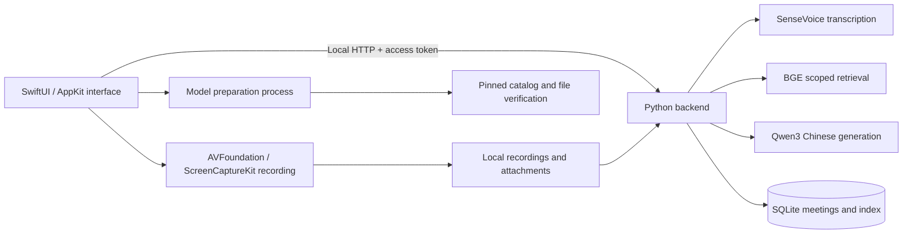

# Zhihui · 知会

[简体中文](README.md) · English

**Turn a conversation into knowledge you can revisit, edit, and ask questions about.**

A native macOS meeting assistant built for Chinese: record audio, transcribe meetings, write Markdown notes, generate Chinese summaries, and ask questions with source citations—all using local inference. SwiftUI provides the desktop interface; SenseVoice, BGE, and Qwen3 provide the AI capabilities.

`macOS 14+` · `Apple Silicon` · `SwiftUI + Metal` · `Python 3.12` · `Local inference`

[Releases](https://github.com/zhutyler21/zhihui/releases) · [Quick start](#quick-start) · [Using Zhihui](#using-zhihui) · [Models and data](#models-and-data) · [Development and validation](#development-and-validation) · [Contributor guide](AGENTS.md)

Current version: **0.4.1 / build 15**. Source: [zhutyler21/zhihui](https://github.com/zhutyler21/zhihui). Releases include the validated macOS arm64 App ZIP and checksums. This is a development build that depends on the project directory, not a standalone installer containing Python and model weights. On another Mac, build from source using the instructions below. The distributed App uses **ad-hoc signing and has not been notarized by Apple**. See [release and installation details](docs/发布与安装.md) (Chinese).

The current application interface is Chinese. This file provides English documentation; Chinese button labels are included where needed.

## Features

| Feature | What you can do |
| --- | --- |
| Meeting management | Create, search, and rename meetings; organize transcripts, notes, summaries, and attachments by meeting |
| Chinese transcription | Record microphone audio, system audio, or both; import existing audio; retain timestamps and edit transcript segments |
| Markdown notes | Edit Markdown source and render headings, lists, tasks, quotes, tables, and code blocks when finished |
| Chinese summaries | Summarize the meeting's transcript, notes, and linked materials, with citations to the source text |
| Local knowledge base | Copy documents locally, extract text, split it into chunks, and build a Chinese vector index |
| Scoped questions | Search the entire knowledge base, all meetings, or one specific meeting; inspect the evidence behind answers |
| Recoverable deletion | Restore individual transcript segments within their meeting; restore meetings and documents from the sidebar Trash |
| Existing-record import | Import compatible Foresight meetings and attachments through a read-only process with duplicate prevention |

The interface uses native sidebars, split views, toolbars, and tables, with sea-salt blue, soft white, and teal accents. Body text uses a 16-point baseline. The moon/sun button at the top right switches directly between dark and light mode; appearance settings in the application menu still offer Follow System. The welcome screen uses SwiftUI and Metal for interactive glass refraction.

## Quick start

### 1. Prepare the environment

| Requirement | Details |
| --- | --- |
| Hardware | Apple Silicon Mac; the current build targets `arm64` |
| Operating system | macOS 14 or later |
| Build tools | Xcode development environment, including command-line tools, and an available Apple Metal Toolchain |
| Python | Python 3.12 in the project's `.venv` |
| Environment manager | `uv` |
| Audio conversion | An installed `ffmpeg` |
| Storage and network | Approximately 2.61 GB for models, plus dependencies, recordings, and attachments; dependency installation and model downloads require internet access |

Get the source, then prepare and build from the **repository root**:

```sh
git clone https://github.com/zhutyler21/zhihui.git
cd zhihui
```

```sh
uv venv --python 3.12 .venv
uv pip install --python .venv/bin/python -r requirements.lock
bash scripts/build-app.sh
```

The Python commands use [uv's explicit interpreter selection](https://docs.astral.sh/uv/pip/environments/). If the build reports a missing Metal Toolchain, install that component and build again:

```sh
xcodebuild -downloadComponent MetalToolchain
```

The result is `dist/知会.app`. The App uses the backend, Python environment, and models through the project path recorded at build time. **Rebuild the App after moving the repository.**

### 2. Install and complete setup

Quit any running Zhihui instance normally before installing:

```sh
.venv/bin/python scripts/install-app.py
```

The installer places the App at `~/Applications/知会.app` and backs up an existing build from the same project under `work/installed-app-backups/`. It checks the App identity, project path, and signature, and rejects bundles configured for isolated test data.

Open the App in Finder and proceed from the welcome screen:

1. Follow macOS prompts to allow microphone and system audio access.
2. Select **Download required models** (`下载所需模型`). Existing files are checked offline and reused.
3. Follow the actual byte progress. Pause a download and select **Continue downloading** (`继续下载`) to resume later.
4. Once both audio permissions and all three models are ready, select **Enter Zhihui** (`进入知会`). The App checks models and permissions again before entry.

macOS groups system audio access under Screen & System Audio Recording. The current recorder receives and saves audio, not screen images. The App does not automatically reset system permissions.

### 3. Optional: prepare models from the command line

Models can also be prepared before opening the App:

```sh
# Download missing or invalid files from the pinned catalog; emit JSON progress lines
.venv/bin/python scripts/setup-models.py --progress-json

# Check existing files without networking; inspect each model's ready status
.venv/bin/python scripts/setup-models.py --status-json
```

Interrupted downloads retain `.partial` files and use range-based resume when the server supports it. Files become available only after size and SHA-256 verification. A successful status-command exit means the check ran; inspect the reported model states to determine readiness.

Running `scripts/setup-models.py` without arguments retains the legacy installation workflow, which generates `models/manifest.json` and collects model license texts. The UI and progress mode use the fixed catalog tracked in this repository.

## Using Zhihui

### From recording to meeting notes

1. **Create and name a meeting.** Click the meeting title to rename it.
2. **Choose an audio source.** Use the microphone for an in-person meeting, system audio for content played on the Mac, or mixed audio for an online meeting with headphones.
3. **Record or import audio.** Stopping a recording saves pending audio for transcription. Review the resulting text and segment timestamps.
4. **Correct and annotate.** Use a segment's “…” menu to edit or delete it. In Notes, select **Edit** (`编辑`) to write Markdown, then **Done** (`完成`) to save and preview it.
5. **Generate a Chinese summary.** Check names, numbers, decisions, owners, and deadlines against the cited source text.

Mixed recording does not provide acoustic echo cancellation. Headphones help prevent speaker playback from being recorded again by the microphone.

### Ask questions about one meeting

Add relevant files in the meeting's **Attachments** (`附件`) tab, then select **Ask this meeting** (`问这场会议`). Alternatively, choose a specific meeting, all meetings, or the entire knowledge base in the question view. Changing the retrieval scope clears the current conversation. Expand answer citations to inspect their source text.

Supported documents include TXT, MD, CSV, JSON, LOG, HTML, text-based PDF, DOCX, PPTX, and XLSX. The App saves a local copy before extracting and indexing text; the original file is unchanged. Scanned PDFs are flagged as requiring OCR. Failed extraction remains visible rather than being reported as a completed index. The single-file limit is 256 MB; Office extraction and text length have additional limits defined in [documents.py](backend/documents.py).

### Delete and restore

- **Transcript segments:** the transcript view shows the meeting's original text. **Deleted segments** (`已删除片段`) in the upper-right opens a separate panel for that meeting. Restored segments return to their original time position.
- **Meetings and documents:** **Trash** (`回收站`) at the bottom of the sidebar manages whole meetings and documents. Deleted content is excluded from normal retrieval.
- **Foresight records:** **Import Foresight meetings** (`导入 Foresight 会议`) reads compatible records while retaining the original database. Email and contacts are not imported automatically.

## Models and data

### Three local models

| Purpose | Model | Runtime | Project directory |
| --- | --- | --- | --- |
| Chinese speech transcription | SenseVoice int8 + Silero VAD | sherpa-onnx / CPU | `models/sensevoice/` |
| Chinese semantic retrieval | BGE-small-zh-v1.5 | FastEmbed / ONNX Runtime / CPU | `models/bge-small-zh/` |
| Chinese summaries and answers | Qwen3-4B-Instruct-2507 4bit | MLX / Apple Silicon GPU | `models/qwen3-4b/` |

[ModelCatalog.json](Resources/ModelCatalog.json) pins download sources, revisions, file sizes, and SHA-256 checksums. It currently contains 23 files totaling **2,614,496,485 bytes**, approximately 2.61 GB. Once prepared, transcription, retrieval, and generation use local files without cloud AI calls.

“Models ready” means the files passed verification. The first task still needs to load its model. File readiness, successful inference, and output quality are separate validation concerns.

### File locations

| Content | Default location |
| --- | --- |
| Source, dependencies, and models | This repository; `.venv/` and `models/` |
| Installed App | `~/Applications/知会.app` |
| Meeting database | `~/Library/Application Support/知会/database.sqlite` |
| Recordings and attachment copies | `recordings/` and `attachments/` within the same data directory |
| Setup completion record | `onboarding.json` within the same data directory |
| Backend log and access token | `backend.log` and `api-token` within the same data directory |
| Development evidence and previous App backups | Repository `work/`, separate from everyday meeting data |

The default backend listens only on `127.0.0.1:8768` and uses a random access token specific to its data directory. Directory permissions are 0700; token permissions are 0600. Data is stored in ordinary local files; application-level database encryption is not implemented. To back up meetings, quit the App and copy the **entire data directory**, including recordings, attachments, and the database.

## How it works



The setup screen invokes a separate model preparation process without starting the meeting backend. The main interface connects to the local service after setup. Retrieval filters by document scope and deletion state before ranking results; answers use retrieved source evidence and display citations.

### Repository layout

```text
.
├── AGENTS.md                 # Development rules and validation requirements
├── README.md                 # Chinese project documentation
├── README.en.md              # English project documentation
├── LICENSE                   # MIT project license
├── Sources/                  # SwiftUI interface, recording, state, and backend lifecycle
├── backend/                  # Extraction, SQLite, indexing, inference, and HTTP service
├── Resources/                # Metal shader and pinned model catalog
├── scripts/                  # Build, installation, model preparation, and validation
├── tests/                    # Python and native Swift regression checks
├── docs/                     # Design, interfaces, validation records, and third-party licenses
├── requirements.lock         # Pinned Python dependencies
├── .venv/                    # Local environment; excluded from Git
├── models/                   # Model files and caches; excluded from Git
├── dist/                     # Built App; excluded from Git
└── work/                     # Isolated validation artifacts; excluded from Git
```

## Development and validation

Read [AGENTS.md](AGENTS.md) before making changes. Some validation scripts and tests contain fixed-path guards for the development machine. When porting them, first establish a separate test root, then adapt the path checks while retaining isolation from everyday data.

### Logic and native state checks

```sh
.venv/bin/python -m unittest discover -s tests -v
bash scripts/test-markdown.sh
bash scripts/test-native-state.sh
bash scripts/test-onboarding.sh
bash scripts/test-model-preparation.sh
bash scripts/test-preflight-shutdown.sh
.venv/bin/python scripts/test-app-icon.py
```

These checks cover storage, scoped retrieval, download protocols, note saving, request races, setup gates, cancellation, and shutdown cleanup. Download tests use real small-file HTTP transfers; they do not constitute a fresh multi-gigabyte download from public model hosts.

### Real-model integration checks

```sh
.venv/bin/python scripts/verify-real-app.py
.venv/bin/python scripts/verify-summary-quality.py
```

Prepared real models are required. `verify-real-app.py` also requires the existing test audio at `work/中文会议验收.aiff`, which is not tracked in Git. The scripts create isolated data directories under `work/` and prohibit external model connections. They check backend and inference behavior, not actual microphone permissions, system audio capture, or native-window interactions.

### Version-specific validation records

The records for 0.4.0 / build 14 include 42 Python tests, native setup and model-process checks, a build of 22 Swift source files, and isolated native checks of download pause/resume and transcript restoration. See the [welcome and setup validation record](docs/欢迎页验收记录.md) for source bindings, installation checks, and data preservation evidence.

For the appearance shortcut and installation checks in 0.4.1 / build 15, see the [appearance validation record](docs/外观切换验收记录.md), which distinguishes isolated preview checks from the installed App’s permission state.

Keep validation claims tied to their version and scope: controlled permission services in previews do not prove actual macOS authorization; file verification does not prove inference quality; results on one Mac do not establish performance across devices. Development tests should use isolated data.

## Troubleshooting

| Situation | What to check |
| --- | --- |
| Audio permission setup remains incomplete | Follow macOS prompts manually and return to the App; signature or path changes may trigger permission rechecks. The project does not automatically reset TCC |
| A model download fails | Read the card's message and check connectivity and free space; retry retains received data and verifies files. Deleting the entire model directory is usually unnecessary |
| Models are ready, but the first task is slow | The model must load on first use; inspect task progress rather than treating file presence as completed generation |
| The backend or Python environment cannot be found | Check the repository path and `.venv`; rebuild after moving the repository |
| The local port is occupied | Identify the conflicting service. Zhihui does not automatically terminate other processes using the port |
| A document was added but has no searchable text | Inspect its extraction status; run OCR on scanned PDFs or convert unsupported formats to TXT or Markdown |
| A summary contains an incorrect name or number | Correct the transcript, inspect source citations, and regenerate. Model output still requires human review |

## Documentation

The detailed project documents and contributor guide below are currently in Chinese.

| Document | Contents |
| --- | --- |
| [Contributor guide](AGENTS.md) | Change scope, data protection, validation, and delivery rules |
| [Release and installation](docs/发布与安装.md) | Release files, signing, dependencies, and publication scope |
| [Acceptance and interfaces](docs/验收与接口.md) | Product capabilities and interface contracts |
| [Backend implementation and validation](docs/后端实现与验证.md) | Storage, retrieval, and task processing |
| [Native interface and recording](docs/原生界面与录音.md) | Windows and audio implementation |
| [Markdown notes](docs/Markdown笔记.md) | Editing, saving, and rendering |
| [Welcome and setup](docs/欢迎与权限引导.md) | First-run setup, model preparation, and entry gates |
| [Interface design](docs/UI设计升级.md) | Colors, typography, and components |
| [Welcome visuals](docs/欢迎页视觉.md) | Glass effects and implementation boundaries |
| [Welcome validation records](docs/欢迎页验收记录.md) | Current and historical validation scope |
| [Interface validation records](docs/界面升级验收记录.md) | Layout and interaction checks |
| [Earlier integration validation](docs/最终验收记录.md) | Integration checks for earlier versions |

## Contributing

Describe the concrete problem or use case, the resulting behavior, how it was validated, and anything not yet verified. Update the relevant documentation when functionality or data flows change. Prefer focused changes that can be reviewed, validated, and rolled back.

## License and acknowledgments

The project's code and documentation are licensed under the **[MIT License](LICENSE)**.

The project uses SwiftUI, Metal, SenseVoice / sherpa-onnx, Silero VAD, BGE / FastEmbed, and MLX / Qwen3, among other tools and models. Third-party license texts are in [docs/licenses/](docs/licenses/). SenseVoice tool code and model weights have different licenses and should be reviewed separately.

Third-party models, weights, and dependencies remain subject to their respective licenses; the project's MIT license does not replace them.
