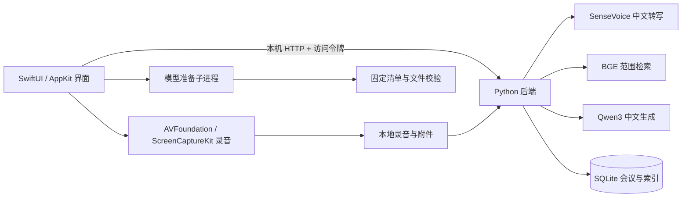

# 知会 · Zhihui

简体中文 · [English](README.en.md)

**把一次讨论，变成可以回看、编辑和提问的知识。**

面向中文会议的 macOS 原生应用：录音、多语言原文转写、实时多语字幕与翻译大屏、Markdown 笔记、中文纪要与带原文引用的问答，都在本机完成。SwiftUI 提供系统质感的工作界面，SenseVoice、BGE 与 Qwen3 负责本地 AI。

`macOS 14+` · `Apple Silicon` · `SwiftUI + Metal` · `Python 3.12` · `本地推理`

[下载 Release](https://github.com/zhutyler21/zhihui/releases) · [快速开始](#快速开始) · [日常使用](#日常使用) · [模型与数据](#模型与数据) · [开发与验证](#开发与验证) · [协作规则](AGENTS.md)

最新发行版本：**0.8.0 / build 21**，包含应用内更新、会议操作区精简、转写与笔记并排、直接点击笔记编辑和会议自动命名。源码仓库：[zhutyler21/zhihui](https://github.com/zhutyler21/zhihui)。独立版以 DMG 分发，应用内包含 Python、后端、固定依赖与音频转换工具，可移动安装，无需保留项目仓库或安装 Homebrew。三个模型在首次设置时由你点击下载。公开发行包采用 **ad-hoc 签名，未经过 Apple 公证**；本机开发构建可使用固定 Apple Development 签名，以保持后续更新的应用身份。见[发布包、签名与安装条件](docs/发布与安装.md)及[0.8.0 发布验收](docs/0.8.0发布验收.md)。

## 能做什么

| 功能 | 使用方式 |
| --- | --- |
| 会议管理 | 新建、搜索、改名；按会议组织转写、笔记、纪要与附件 |
| 多语言转写 | 录制麦克风、系统声音或混音，也可导入已有音频；保留片段时间并支持校对 |
| 粤语转写 | 在“语言设置… → 讲话语言”选“粤语”；可关闭翻译，只保存粤语原文并整理中文纪要，无需额外模型 |
| 本地实时翻译 | 中、英、日、韩互译，可同时选择多种译文；原文和译文逐段对应，支持补译、失败重试与多语导出 |
| 实时翻译大屏 | 独立窗口并排显示原文和最多四种译文，可移到外接屏全屏；支持字号、深浅色、暂停与跟随最新 |
| Markdown 笔记 | 编辑时使用源码，完成后渲染标题、列表、待办、引用、表格与代码块 |
| 中文纪要 | 从本场会议转写、笔记及关联资料整理纪要，并提供原文引用 |
| 本地知识库 | 保存附件副本，抽取文字、分块并建立中文向量索引 |
| 按范围提问 | 选择全部知识库、全部会议或某场会议；展开引用核对回答 |
| 可恢复删除 | 单段转写在会议内恢复；整场会议与资料通过侧栏底部回收站恢复 |
| 原记录迁移 | 只读导入已有 Foresight 会议与兼容附件，重复导入防重复 |

界面采用原生侧栏、分栏、工具栏与表格，使用海盐蓝、雾白和青绿。正文以 16 号字为基准；主界面右上角的月亮／太阳按钮可直接切换深浅色，在应用菜单的外观设置中仍可选择跟随系统。欢迎页以 SwiftUI 与 Metal 实现可交互的玻璃折射。

## 快速开始

### 1. 下载并安装

| 项目 | 要求 |
| --- | --- |
| 电脑 | Apple Silicon Mac；发行包为 `arm64` |
| 系统 | macOS 14 或更高 |
| 运行环境 | 已包含在应用内，无需另装 Python、ffmpeg 或 Homebrew |
| 存储与网络 | 模型约 2.61 GB，另需应用、录音与附件空间；首次下载模型需要网络 |

1. 在 [v0.8.0 Release](https://github.com/zhutyler21/zhihui/releases/tag/v0.8.0) 下载 `Zhihui-v0.8.0-macOS-arm64.dmg`。
2. 打开 DMG，把“知会”拖入其中的“应用程序”文件夹。
3. 从已安装的位置打开“知会”，按 macOS 提示处理首次打开与声音访问。

应用从自身所在位置读取运行环境。移动 App 不需要重建；会议资料与模型保存在用户资料目录，不会随 App 一起移动。下载附件及其校验方式见[发布包与安装条件](docs/发布与安装.md)。

### 2. 完成首次设置

从欢迎页进入设置：

1. 按 macOS 提示准备麦克风与系统声音权限。
2. 点击“下载所需模型”；已有文件会离线校验并继续使用。
3. 查看真实字节进度。可暂停，之后点击“继续下载”。
4. 两项声音权限与三个模型均完成后，点击“进入知会”。进入前再次校验模型与授权。

模型下载到 `~/Library/Application Support/知会/models/`，不写入应用包。通过项目安装器升级本机旧开发版时，会按固定清单验证并复制可复用的旧模型；原模型保留，不会为了升级强制重新下载。

macOS 将系统声音权限列在“录屏与系统录音”中。当前录音器只接收和保存音频，不保存屏幕图像。应用不会自动重置系统授权。三个模型准备完成后，日常转写、检索与生成可以离线运行。

## 日常使用

### 从录音到会议纪要

会议默认打开资料页，顶部只保留一组“开始录音”“导入音频”；点击录音按钮直接开始，旁边的箭头选择声音来源。空白页只显示提示，不重复操作。各页面右上角都有带文字的“新建会议”。宽窗口默认同时显示转写与笔记，可拖动分隔线调整；窄窗口上下排列，也可用内容标签右侧的分栏图标关闭并排，专注阅读。点击“实时会场”进入翻译和投屏控制页；返回后保留内容标签和笔记草稿。离开前先保存笔记，保存失败时留在当前页。大屏始终是另一扇独立窗口。

1. **新建会议**：点击右上角“新建会议”。可以点击标题手动命名，也可以在生成纪要时自动命名。
2. **选择声音来源**：点击“开始录音”右侧的箭头选择；现场会议用麦克风；Mac 播放内容用系统声音；戴耳机的在线会议用混音。
3. **录音或导入音频**：直接点击会议页的对应按钮。录音期间，内容区顶部持续显示计时、“停止录音”和“停止并整理”，切换到知识库或提问也可停止。停止会保存录音并继续转写；停止并整理会等待本场转写完成，再生成纪要。
4. **对照原文补充笔记**：转写与笔记可同时显示；片段右上角“…”可校对或删除；空白笔记直接输入 Markdown，已有笔记点击内容继续输入；更改自动保存，点击笔记区域外自动排版，⌘Return 也可结束编辑。
5. **生成中文纪要**：根据原文引用核对人名、数字、决定、负责人和期限。未手动命名的会议会根据纪要自动生成主题名称，再次整理时也会更新；手动保存过的名称保持不变。命名失败仍保存有效纪要，并保留现有名称。

在实时会场的“实时翻译”区域点击“语言设置…”选择讲话语言与译文语言，用旁边的开关即可开启或关闭实时翻译。实时翻译以约 2–6 秒短块保存原文后处理，另外有推理、排队和刷新延迟；混音时间线另有约 2 秒缓冲。已有原文可点击“翻译已有原文”；“停止并整理”会等待本场原文完成再整理中文纪要。数字或常见相对时间核对不通过时不会保存该译文。完整模型分工、参考站点研究与限制见[多语言实时翻译与模型体系](docs/多语言实时翻译与模型体系.md)。

粤语会议进入实时会场后，在“语言设置…”中选择“讲话语言 → 粤语”，保存设置后开始录音或导入音频。不需要翻译时保持“实时翻译”关闭，粤语识别仍生效；“自动识别”也可识别粤语，本轮只用一条合成声音做了验证，不承诺所有口音。原文可能保留“我哋”“蚊”等粤语口语，整理纪要时生成简体中文。见[粤语转写验收](docs/粤语转写验收记录.md)。

### 大型会议的实时翻译大屏

先点击“进入实时会场”，在“实时翻译”区域点击“语言设置…”，勾选需要的中文、英文、日文、韩文译文，保存后开启翻译；粤语也可以作为讲话语言。点击同一区域右侧的“打开翻译大屏”，把独立窗口拖到外接显示器或投影仪，再点“全屏”（Esc 退出）。主窗口继续负责录音和会后整理。

大屏将最新发言放在最顶部，原文与各语言译文按同一段发言并排对齐，译文完成后逐栏更新；“跟随最新”会自动回到顶部。会议转写页仍按时间从早到晚排列，最新内容在底部。可隐藏原文、调整 24–64 号字、切换深浅色、暂停显示或关闭“跟随最新”向下回看较早内容。暂停只冻结显示，后台继续录音与翻译；“补齐译文”补充缺失或失败的译文。大屏只显示本场最近 30 段，完整原文、译文和纪要仍在会议中保存。

所有目标语言共用一个本地文字模型，依次生成，语言越多可能等待越久；长发言或较小窗口需要滚动或缩小字号。当前提供本机独立窗口与外接屏展示，未提供局域网网页链接或跨设备同步。已在本机外接显示器检查移动与全屏；其他显示设备和长时间会议的稳定性仍未验证。操作与证据见[实时翻译大屏验收记录](docs/实时翻译大屏验收记录.md)。

混音模式没有声学回声消除。在线会议使用耳机，可以减少扬声器声音再次进入麦克风。

### 围绕某场会议提问

在会议的“附件”页添加相关文件，再点击“问这场会议”。也可以在“提问”页选择指定会议、全部会议或全部知识库。切换检索范围会清空当前对话，回答中的引用可以展开查看原文。

文件支持 TXT、MD、CSV、JSON、LOG、HTML、文字 PDF、DOCX、PPTX 与 XLSX。文件先保存本地副本，再抽取文字与建立索引，原文件保持不变。扫描 PDF 会提示先做 OCR；读取失败的资料保留可见状态，不会显示为已完成索引。单文件上限为 256 MB，Office 解压及文字读取另有边界，见 [documents.py](backend/documents.py)。

### 删除与恢复

- **转写片段**：转写区直接显示会议原文。右上角“已删除片段（数量）”打开本场会议的独立面板，恢复后回到原时间位置。
- **会议与资料**：侧栏底部“回收站”管理整场会议与资料，删除内容不参与正常检索。
- **原 Foresight 记录**：通过“导入 Foresight 会议”读取兼容数据，保留原数据库；不会自动导入邮件或通讯录。

## 应用内更新

从 0.8.0 起，独立版会每天自动检查 GitHub 新版本，也可使用菜单“知会 → 检查更新…”或“设置 → 软件更新”。发现新版后，确认下载并安装，应用会保存笔记、正常退出并重新启动。录音、模型下载或会议任务进行中会暂缓更新；下载期间开始录音时，安装会延后，完成后在设置点击“安装更新并重启”。设置中可关闭自动检查，仍可手动检查。

更新只替换 App，会议资料、录音、模型继续保存在原用户资料目录。联网请求只用于获取发行清单和安装包，不上传会议内容；版本清单和安装包均验证 Ed25519 签名。声音权限能否沿用还取决于新旧版本的应用标识、代码签名与 macOS，更新器不会重置或绕过授权。

**0.5.0 没有更新器，旧用户需先手动安装一次 0.8.0。** 后续版本通过正式 GitHub Release 的签名安装包和 `appcast.xml` 分发，单纯推送代码不会触发更新。源码开发包关闭发行更新。发布步骤见[自动更新与发布](docs/自动更新与发布.md)。

## 模型与数据

### 三个本地模型

| 用途 | 模型 | 推理方式 | 模型目录下的文件夹 |
| --- | --- | --- | --- |
| 中英日韩粤语转写 | SenseVoice int8 + Silero VAD | sherpa-onnx / CPU | `sensevoice/` |
| 中文语义检索 | BGE-small-zh-v1.5 | FastEmbed / ONNX Runtime / CPU | `bge-small-zh/` |
| 中英日韩翻译、中文纪要与问答 | Qwen3-4B-Instruct-2507 4bit | MLX / Apple Silicon GPU | `qwen3-4b/` |

独立版模型目录为 `~/Library/Application Support/知会/models/`；源码开发模式默认使用仓库的 `models/`。

[ModelCatalog.json](Resources/ModelCatalog.json) 固定下载来源、revision、文件大小与 SHA-256。目前包含 23 个文件，共 **2,614,496,485 字节**，约 2.61 GB。模型准备后，转写、检索和生成使用本地文件，不调用云端 AI。

“模型已准备”表示文件通过检查；首次执行相应任务仍需要加载模型。模型就绪、推理成功与生成质量是不同的验证项。

### 文件放在哪里

| 内容 | 默认位置 |
| --- | --- |
| 源码与开发环境 | 本仓库；`.venv/`、开发用 `models/` |
| 已安装应用 | DMG 默认拖入 `/Applications/知会.app`；项目安装器使用 `~/Applications/知会.app` |
| 独立版运行环境 | `知会.app/Contents/Resources/Runtime/`，从当前应用位置读取 |
| 独立版模型与缓存 | `~/Library/Application Support/知会/models/` |
| 会议数据库 | `~/Library/Application Support/知会/database.sqlite` |
| 录音与附件副本 | 同一资料目录中的 `recordings/`、`attachments/` |
| 引导完成记录 | 同一资料目录中的 `onboarding.json` |
| 服务日志与访问令牌 | 同一资料目录中的 `backend.log`、`api-token` |
| 开发验证与旧应用备份 | 仓库 `work/`，与日常资料分开 |

默认后端只监听 `127.0.0.1:8768`，使用资料目录独立的随机访问令牌；目录权限为 0700，令牌为 0600。数据保存在普通本地文件中，本项目未实现应用级数据库加密。备份时先退出应用，再备份**整个资料目录**，以同时保留录音、附件与数据库。

## 工作原理



设置页直接调用独立模型准备进程，不提前启动会议后台。进入主界面后才连接本机服务。检索先限定资料范围并排除已删除内容，再计算相关性；模型依据检索到的原文证据回答并显示引用。

### 仓库结构

```text
.
├── AGENTS.md                 # 开发协作规则与验证要求
├── README.md                 # 项目入口
├── README.en.md              # 英文项目介绍与使用说明
├── LICENSE                   # MIT 项目许可证
├── Sources/                  # SwiftUI 界面、录音、状态与后端生命周期
├── backend/                  # 资料读取、SQLite、索引、推理与 HTTP 服务
├── Resources/                # Metal 着色器、固定模型清单与运行环境配置
├── scripts/                  # 构建、安装、模型准备与验证工具
├── tests/                    # Python 与原生 Swift 回归检查
├── docs/                     # 设计、接口、验收记录与第三方许可
├── requirements.lock         # 固定 Python 依赖
├── .venv/                    # 本地环境，不提交
├── models/                   # 源码开发用模型与缓存，不提交
├── dist/                     # 构建应用，不提交
└── work/                     # 隔离验证与开发证据，不提交
```

## 开发与验证

开始改动前阅读 [AGENTS.md](AGENTS.md)。当前部分验证脚本和测试含本机固定路径保护；移植到其他电脑时，应先确定独立测试根目录，再适配路径检查，保留与日常资料隔离的约束。

### 从源码构建独立版

开发需要 Apple Silicon、Xcode 开发环境（含命令行工具）、Apple Metal Toolchain、CMake 3.25 或更高，以及 `uv`。发布运行环境固定为受管理的 **CPython 3.12.11**，依赖使用 [requirements.lock](requirements.lock)；运行配置见 [StandaloneRuntime.json](Resources/StandaloneRuntime.json)。构建过程从固定来源准备运行环境与 FFmpeg，并以 macOS 14 为目标编译相同版本的 MLX，保留预编译 Metal 内核，不依赖已安装的 Homebrew ffmpeg。CMake 和编译工具仅在开发构建时使用。

在仓库根目录执行：

```sh
git clone https://github.com/zhutyler21/zhihui.git
cd zhihui
```

```sh
uv python install 3.12.11
uv venv --python 3.12.11 --managed-python .venv
uv pip install --python .venv/bin/python -r requirements.lock
source .venv/bin/activate
bash scripts/build-standalone.sh
python3 scripts/build-dmg.py
```

命令采用 [uv 的受管理 Python](https://docs.astral.sh/uv/concepts/python-versions/)和[指定解释器安装方式](https://docs.astral.sh/uv/pip/environments/)。如果编译提示缺少 Metal Toolchain，可安装组件后重新构建：

```sh
xcodebuild -downloadComponent MetalToolchain
```

独立应用输出到 `dist/知会.app`，DMG 输出到 `dist/`。先正常退出旧版，再用项目安装器安装到 `~/Applications/知会.app`：

```sh
python3 scripts/install-app.py
```

安装器核验应用身份、运行布局与签名，拒绝隔离验收包，并在 `work/installed-app-backups/` 保留旧应用。旧开发版的模型仅在固定清单校验通过后复制到独立版模型目录；会议数据库、录音与附件仍使用原资料目录。

`bash scripts/build-app.sh` 仍提供依赖源码目录的原生开发包；这类开发包使用项目 `.venv`、后端和 `models/`，移动仓库后需要重新构建。正式 Release 使用独立版构建入口。

### 可选：开发环境准备模型

```sh
# 按固定清单下载缺失或校验失败的文件，输出逐行 JSON 进度
.venv/bin/python scripts/setup-models.py --progress-json

# 只检查已有文件，无需联网；查看各模型 ready 状态
.venv/bin/python scripts/setup-models.py --status-json
```

源码模式默认写入仓库 `models/`；可通过 `--model-dir` 指定可写的独立模型目录。下载中断保留 `.partial` 文件，服务器支持时续传，文件大小与 SHA-256 验证通过后才发布。检查命令成功退出只表示检查已执行，准备结果以模型状态为准。无参数入口保留兼容安装流程，生成模型 `manifest.json` 并整理许可文本；界面下载与进度模式始终使用固定清单。

### 逻辑与原生状态检查

```sh
.venv/bin/python -m unittest discover -s tests -v
bash scripts/test-markdown.sh
bash scripts/test-native-state.sh
bash scripts/test-onboarding.sh
bash scripts/test-model-preparation.sh
bash scripts/test-preflight-shutdown.sh
bash scripts/test-standalone-runtime-swift.sh
.venv/bin/python scripts/test-app-icon.py
```

这些检查覆盖资料与范围检索、下载协议、笔记保存、请求竞态、引导门禁、进程取消和退出清理等。下载测试使用真实小文件 HTTP；它不代表重新下载了数 GB 公网权重。

### 真实模型集成检查

```sh
.venv/bin/python scripts/verify-real-app.py
.venv/bin/python scripts/verify-summary-quality.py
.venv/bin/python scripts/verify-projection.py
.venv/bin/python scripts/verify-translation.py --audio-dir work/live-translation-20261016/audio --port 8796
```

需要已准备的真实模型。`verify-real-app.py` 还需要现有隔离测试音频 `work/中文会议验收.aiff`，该文件不随 Git 提交。脚本在 `work/` 创建独立资料目录，禁止模型连接外网；检查后端与推理行为，不替代真实麦克风、系统声音或原生窗口验收。

大屏集成检查另需 `work/live-translation-20261016/audio/zh.aiff` 和 `work/cantonese-20261016/audio/yue.aiff`，使用独立资料及端口 8892；检查一段原文生成多语译文、中文纪要和导出。测试声音不随仓库分发。

四语检查需要上述 `--audio-dir` 下自备合成的 `zh.aiff`、`en.aiff`、`ja.aiff`、`ko.aiff`；检查四条转写、12 个翻译方向、中文纪要与导出。它不等于所有专名与语义准确。本轮曾观察到人名与日韩措辞错误，重要内容应对照原文校对。

### 版本验证记录

0.8.0 / build 21 增加 Sparkle 应用内检查、签名验证及更新发布工具，见[自动更新与发布](docs/自动更新与发布.md)。

0.7.2 / build 20 优化录音入口、全局停止操作与转写笔记并排布局，见[会议交互优化验收](docs/会议交互优化验收.md)。

0.7.1 / build 19 默认以会议资料为主，将录音、翻译和大屏操作移到单独的实时会场页面，保留独立大屏窗口；页面切换、笔记保护、深浅色、窄窗口及安装验证见[翻译入口体验调整](docs/翻译入口体验调整.md)。

0.7.0 / build 18 的并排大屏、多目标翻译、原生窗口、移动运行与安装证据见[实时翻译大屏验收记录](docs/实时翻译大屏验收记录.md)。

0.6.0 / build 17 的多语言功能、模型、原生窗口、独立包和实际限制见[多语言翻译验收记录](docs/多语言翻译验收记录.md)。本轮按用户要求跳过系统权限配置和真实硬件录音验收。

0.5.0 / build 16 的运行环境封装、移动运行、DMG、安装与资料保留证据见[独立安装验收记录](docs/独立安装验收记录.md)。以下 0.4 系列记录保留其原版本范围，不作为本版全部功能的验收结论。

0.4.0 / build 14 已记录 Python 42 项测试、原生引导与模型进程检查、22 个 Swift 源文件的构建，以及下载暂停/继续和片段恢复的隔离原生验证。具体来源、安装和数据保留证据见 [欢迎页验收记录](docs/欢迎页验收记录.md)。

0.4.1 / build 15 的外观快捷切换及安装验证见 [外观切换验收记录](docs/外观切换验收记录.md)，其中明确区分独立预览与本机授权状态。

记录按版本保留范围：原生预览使用受控权限服务，不能当作真实系统授权证明；文件校验不能当作推理质量证明；本机结果不承诺所有设备上的性能。开发测试应使用隔离资料。

## 常见问题

| 情况 | 检查方式 |
| --- | --- |
| 设置页仍显示声音权限未完成 | 按 macOS 提示手动处理后返回检查；签名或应用路径变化可能触发系统重新校验，本项目不自动重置 TCC |
| 模型下载失败 | 查看卡片提示、网络和剩余空间；再次下载会保留已接收内容并校验，通常无需删除整个模型目录 |
| 显示模型就绪，但首次任务较慢 | 首次任务需要加载对应模型；查看任务状态，不以文件存在判断生成已成功 |
| 独立版提示运行环境不完整 | 从 Release 重新下载完整 App；不要单独替换应用内运行文件。源码开发包需核对仓库和 `.venv`，移动仓库后重新构建 |
| 本机端口被占用 | 核对冲突服务的身份；知会不会自动结束占用端口的其他进程 |
| 文件已添加，但没有可检索正文 | 查看读取状态；扫描 PDF 先做 OCR，不支持的格式可另存为 TXT 或 Markdown |
| 摘要中的人名或数字有误 | 先校对转写，再核对原文引用并重新生成；模型结果需要人工复核 |

## 文档导航

| 文档 | 内容 |
| --- | --- |
| [开发协作规则](AGENTS.md) | 改动范围、数据保护、验证与交付要求 |
| [发布包与安装条件](docs/发布与安装.md) | Release 文件、签名、环境依赖与公开范围 |
| [会议交互优化验收](docs/会议交互优化验收.md) | 0.7.2 的操作入口、并排笔记与保存验证 |
| [翻译入口体验调整](docs/翻译入口体验调整.md) | 0.7.1 的资料 / 会场分工、笔记保护与双屏验证 |
| [实时翻译大屏](docs/实时翻译大屏验收记录.md) | 0.7.0 多语并排与安装验证；0.7.2 最新字幕置顶 |
| [验收与接口](docs/验收与接口.md) | 产品切片与接口约定 |
| [后端实现与验证](docs/后端实现与验证.md) | 数据、检索和任务处理 |
| [原生界面与录音](docs/原生界面与录音.md) | 原生窗口与音频实现 |
| [Markdown 笔记](docs/Markdown笔记.md) | 编辑、保存和渲染行为 |
| [欢迎与权限引导](docs/欢迎与权限引导.md) | 首次设置、模型准备与进入门禁 |
| [界面设计升级](docs/UI设计升级.md) | 配色、字体与组件规范 |
| [欢迎页视觉](docs/欢迎页视觉.md) | 玻璃效果的视觉与实现边界 |
| [独立安装验收记录](docs/独立安装验收记录.md) | 0.5.0 的运行环境、移动运行、DMG 与安装证据 |
| [欢迎页验收记录](docs/欢迎页验收记录.md) | 0.4 系列的欢迎页与模型验证范围 |
| [界面升级验收记录](docs/界面升级验收记录.md) | 布局及交互增量验证 |
| [早期完整验收](docs/最终验收记录.md) | 早期版本的集成验证 |

## 参与开发

提交改动时写清：具体问题或使用场景、最终行为、验证方式，以及未验证的部分。功能或数据流程变化，同步更新相关文档；优先完成一个范围清楚、可回滚、可验证的改动。

## 许可与致谢

本项目代码与文档采用 **[MIT License](LICENSE)**。

项目依赖 SwiftUI、Metal、SenseVoice / sherpa-onnx、Silero VAD、BGE / FastEmbed、MLX / Qwen3 等工具与模型；独立版还分发 Python 运行环境、FFmpeg 与固定 Python 依赖。第三方许可保存在 [docs/licenses/](docs/licenses/)；SenseVoice 工具代码和模型权重使用不同许可，应分别查看。

应用包内保留第三方许可与说明；Release 同时提供所分发 FFmpeg 的对应源码与构建配置说明。第三方模型、权重与依赖仍按各自许可使用与分发，不受本项目 MIT 许可替代。
