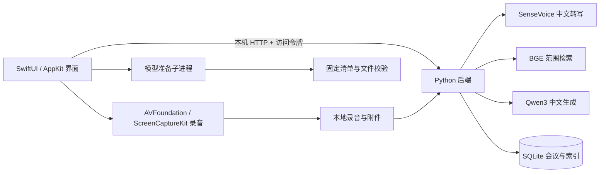

# 知会 · Zhihui

简体中文 · [English](README.en.md)

**把一次讨论，变成可以回看、编辑和提问的知识。**

面向中文会议的 macOS 原生应用：录音、转写、Markdown 笔记、中文纪要与带原文引用的问答，都在本机完成。SwiftUI 提供系统质感的工作界面，SenseVoice、BGE 与 Qwen3 负责本地 AI。

`macOS 14+` · `Apple Silicon` · `SwiftUI + Metal` · `Python 3.12` · `本地推理`

[下载 Release](https://github.com/zhutyler21/zhihui/releases) · [快速开始](#快速开始) · [日常使用](#日常使用) · [模型与数据](#模型与数据) · [开发与验证](#开发与验证) · [协作规则](AGENTS.md)

当前版本：**0.4.0 / build 14**。源码仓库：[zhutyler21/zhihui](https://github.com/zhutyler21/zhihui)。Release 提供已验证的 macOS arm64 应用 ZIP 与校验文件。这是依赖项目目录运行的开发版，尚未提供包含 Python 环境与模型的独立安装包；其他电脑优先按下方流程从源码构建。见[发布包与安装条件](docs/发布与安装.md)。

## 能做什么

| 功能 | 使用方式 |
| --- | --- |
| 会议管理 | 新建、搜索、改名；按会议组织转写、笔记、纪要与附件 |
| 中文转写 | 录制麦克风、系统声音或混音，也可导入已有音频；保留片段时间并支持校对 |
| Markdown 笔记 | 编辑时使用源码，完成后渲染标题、列表、待办、引用、表格与代码块 |
| 中文纪要 | 从本场会议转写、笔记及关联资料整理纪要，并提供原文引用 |
| 本地知识库 | 保存附件副本，抽取文字、分块并建立中文向量索引 |
| 按范围提问 | 选择全部知识库、全部会议或某场会议；展开引用核对回答 |
| 可恢复删除 | 单段转写在会议内恢复；整场会议与资料通过侧栏底部回收站恢复 |
| 原记录迁移 | 只读导入已有 Foresight 会议与兼容附件，重复导入防重复 |

界面采用原生侧栏、分栏、工具栏与表格，使用海盐蓝、雾白和青绿。正文以 16 号字为基准，支持跟随系统、浅色与深色外观；欢迎页以 SwiftUI 与 Metal 实现可交互的玻璃折射。

## 快速开始

### 1. 准备环境

| 项目 | 要求 |
| --- | --- |
| 电脑 | Apple Silicon Mac；当前构建目标为 `arm64` |
| 系统 | macOS 14 或更高 |
| 编译工具 | Xcode 开发环境（含命令行工具）；可用的 Apple Metal Toolchain |
| Python | Python 3.12，使用项目内 `.venv` |
| 环境管理 | `uv` |
| 音频转换 | 已安装的 `ffmpeg` |
| 存储与网络 | 模型约 2.61 GB，另需依赖、录音与附件空间；安装依赖和下载模型需要网络 |

先取得源码，然后在**仓库根目录**准备环境与构建：

```sh
git clone https://github.com/zhutyler21/zhihui.git
cd zhihui
```

```sh
uv venv --python 3.12 .venv
uv pip install --python .venv/bin/python -r requirements.lock
bash scripts/build-app.sh
```

Python 环境命令采用 [uv 的指定解释器安装方式](https://docs.astral.sh/uv/pip/environments/)。如果编译提示缺少 Metal Toolchain，可先安装该组件，再重新构建：

```sh
xcodebuild -downloadComponent MetalToolchain
```

构建结果位于 `dist/知会.app`。应用通过构建时写入的路径使用项目中的后端、Python 环境与模型；**移动仓库后需要重新构建**。

### 2. 安装与首次启动

先正常退出已运行的知会，再执行：

```sh
.venv/bin/python scripts/install-app.py
```

安装到 `~/Applications/知会.app`，已有本项目版本会备份到 `work/installed-app-backups/`。安装器核验应用身份、项目路径与签名，并拒绝带隔离验收配置的应用包。

从访达打开应用，按欢迎页进入设置：

1. 按 macOS 提示准备麦克风与系统声音权限。
2. 点击“下载所需模型”；已有文件会离线校验并继续使用。
3. 查看真实字节进度。可暂停，之后点击“继续下载”。
4. 两项声音权限与三个模型均完成后，点击“进入知会”。进入前再次校验模型与授权。

macOS 将系统声音权限列在“录屏与系统录音”中。当前录音器只接收和保存音频，不保存屏幕图像。应用不会自动重置系统授权。

### 3. 可选：在命令行准备模型

也可以在打开应用前下载模型：

```sh
# 按固定清单下载缺失或校验失败的文件，输出逐行 JSON 进度
.venv/bin/python scripts/setup-models.py --progress-json

# 只检查已有文件，无需联网；查看各模型 ready 状态
.venv/bin/python scripts/setup-models.py --status-json
```

下载中断时保留 `.partial` 文件，服务端支持时使用断点续传。文件大小与 SHA-256 验证通过后才发布为正式模型文件。检查命令退出成功表示检查已执行，是否准备完成以输出中的模型状态为准。

无参数的 `scripts/setup-models.py` 保留兼容安装流程，会生成 `models/manifest.json` 并整理模型许可文本；界面下载与上述进度模式使用版本控制中的固定清单。

## 日常使用

### 从录音到会议纪要

1. **新建并命名会议**：点击会议标题即可改名。
2. **选择声音来源**：现场会议用麦克风；Mac 播放内容用系统声音；戴耳机的在线会议用混音。
3. **录音或导入音频**：停止后保存待处理音频并完成转写，查看片段时间和正文。
4. **校对与补充**：片段右上角“…”可校对或删除；笔记点“编辑”输入 Markdown，点“完成”保存并预览。
5. **生成中文纪要**：根据原文引用核对人名、数字、决定、负责人和期限。

混音模式没有声学回声消除。在线会议使用耳机，可以减少扬声器声音再次进入麦克风。

### 围绕某场会议提问

在会议的“附件”页添加相关文件，再点击“问这场会议”。也可以在“提问”页选择指定会议、全部会议或全部知识库。切换检索范围会清空当前对话，回答中的引用可以展开查看原文。

文件支持 TXT、MD、CSV、JSON、LOG、HTML、文字 PDF、DOCX、PPTX 与 XLSX。文件先保存本地副本，再抽取文字与建立索引，原文件保持不变。扫描 PDF 会提示先做 OCR；读取失败的资料保留可见状态，不会显示为已完成索引。单文件上限为 256 MB，Office 解压及文字读取另有边界，见 [documents.py](backend/documents.py)。

### 删除与恢复

- **转写片段**：转写区直接显示会议原文。右上角“已删除片段（数量）”打开本场会议的独立面板，恢复后回到原时间位置。
- **会议与资料**：侧栏底部“回收站”管理整场会议与资料，删除内容不参与正常检索。
- **原 Foresight 记录**：通过“导入 Foresight 会议”读取兼容数据，保留原数据库；不会自动导入邮件或通讯录。

## 模型与数据

### 三个本地模型

| 用途 | 模型 | 推理方式 | 项目内目录 |
| --- | --- | --- | --- |
| 中文语音转写 | SenseVoice int8 + Silero VAD | sherpa-onnx / CPU | `models/sensevoice/` |
| 中文语义检索 | BGE-small-zh-v1.5 | FastEmbed / ONNX Runtime / CPU | `models/bge-small-zh/` |
| 中文纪要与问答 | Qwen3-4B-Instruct-2507 4bit | MLX / Apple Silicon GPU | `models/qwen3-4b/` |

[ModelCatalog.json](Resources/ModelCatalog.json) 固定下载来源、revision、文件大小与 SHA-256。目前包含 23 个文件，共 **2,614,496,485 字节**，约 2.61 GB。模型准备后，转写、检索和生成使用本地文件，不调用云端 AI。

“模型已准备”表示文件通过检查；首次执行相应任务仍需要加载模型。模型就绪、推理成功与生成质量是不同的验证项。

### 文件放在哪里

| 内容 | 默认位置 |
| --- | --- |
| 源码、依赖、模型 | 本仓库；`.venv/`、`models/` |
| 已安装应用 | `~/Applications/知会.app` |
| 会议数据库 | `~/Library/Application Support/知会/database.sqlite` |
| 录音与附件副本 | 同一资料目录中的 `recordings/`、`attachments/` |
| 引导完成记录 | 同一资料目录中的 `onboarding.json` |
| 服务日志与访问令牌 | 同一资料目录中的 `backend.log`、`api-token` |
| 开发验证与旧应用备份 | 仓库 `work/`，与日常资料分开 |

默认后端只监听 `127.0.0.1:8768`，使用资料目录独立的随机访问令牌；目录权限为 0700，令牌为 0600。数据保存在普通本地文件中，本项目未实现应用级数据库加密。备份时先退出应用，再备份**整个资料目录**，以同时保留录音、附件与数据库。

## 工作原理



设置页直接调用独立模型准备进程，不提前启动会议后台。进入主界面后才连接本机服务。检索先限定资料范围并排除已删除内容，再计算相关性；模型依据检索到的原文证据回答并显示引用。

### 仓库结构

```text
.
├── AGENTS.md                 # 开发协作规则与验证要求
├── README.md                 # 项目入口
├── README.en.md              # 英文项目介绍与使用说明
├── Sources/                  # SwiftUI 界面、录音、状态与后端生命周期
├── backend/                  # 资料读取、SQLite、索引、推理与 HTTP 服务
├── Resources/                # Metal 着色器与固定模型清单
├── scripts/                  # 构建、安装、模型准备与验证工具
├── tests/                    # Python 与原生 Swift 回归检查
├── docs/                     # 设计、接口、验收记录与第三方许可
├── requirements.lock         # 固定 Python 依赖
├── .venv/                    # 本地环境，不提交
├── models/                   # 模型与缓存，不提交
├── dist/                     # 构建应用，不提交
└── work/                     # 隔离验证与开发证据，不提交
```

## 开发与验证

开始改动前阅读 [AGENTS.md](AGENTS.md)。当前部分验证脚本和测试含本机固定路径保护；移植到其他电脑时，应先确定独立测试根目录，再适配路径检查，保留与日常资料隔离的约束。

### 逻辑与原生状态检查

```sh
.venv/bin/python -m unittest discover -s tests -v
bash scripts/test-markdown.sh
bash scripts/test-native-state.sh
bash scripts/test-onboarding.sh
bash scripts/test-model-preparation.sh
bash scripts/test-preflight-shutdown.sh
.venv/bin/python scripts/test-app-icon.py
```

这些检查覆盖资料与范围检索、下载协议、笔记保存、请求竞态、引导门禁、进程取消和退出清理等。下载测试使用真实小文件 HTTP；它不代表重新下载了数 GB 公网权重。

### 真实模型集成检查

```sh
.venv/bin/python scripts/verify-real-app.py
.venv/bin/python scripts/verify-summary-quality.py
```

需要已准备的真实模型。`verify-real-app.py` 还需要现有隔离测试音频 `work/中文会议验收.aiff`，该文件不随 Git 提交。脚本在 `work/` 创建独立资料目录，禁止模型连接外网；检查后端与推理行为，不替代真实麦克风、系统声音或原生窗口验收。

### 版本验证记录

0.4.0 / build 14 已记录 Python 42 项测试、原生引导与模型进程检查、22 个 Swift 源文件的构建，以及下载暂停/继续和片段恢复的隔离原生验证。具体来源、安装和数据保留证据见 [欢迎页验收记录](docs/欢迎页验收记录.md)。

记录按版本保留范围：原生预览使用受控权限服务，不能当作真实系统授权证明；文件校验不能当作推理质量证明；本机结果不承诺所有设备上的性能。开发测试应使用隔离资料。

## 常见问题

| 情况 | 检查方式 |
| --- | --- |
| 设置页仍显示声音权限未完成 | 按 macOS 提示手动处理后返回检查；签名或应用路径变化可能触发系统重新校验，本项目不自动重置 TCC |
| 模型下载失败 | 查看卡片提示、网络和剩余空间；再次下载会保留已接收内容并校验，通常无需删除整个模型目录 |
| 显示模型就绪，但首次任务较慢 | 首次任务需要加载对应模型；查看任务状态，不以文件存在判断生成已成功 |
| 找不到后端或 Python 环境 | 确认仓库位置及 `.venv`；移动仓库后重新构建应用 |
| 本机端口被占用 | 核对冲突服务的身份；知会不会自动结束占用端口的其他进程 |
| 文件已添加，但没有可检索正文 | 查看读取状态；扫描 PDF 先做 OCR，不支持的格式可另存为 TXT 或 Markdown |
| 摘要中的人名或数字有误 | 先校对转写，再核对原文引用并重新生成；模型结果需要人工复核 |

## 文档导航

| 文档 | 内容 |
| --- | --- |
| [开发协作规则](AGENTS.md) | 改动范围、数据保护、验证与交付要求 |
| [发布包与安装条件](docs/发布与安装.md) | Release 文件、签名、环境依赖与公开范围 |
| [验收与接口](docs/验收与接口.md) | 产品切片与接口约定 |
| [后端实现与验证](docs/后端实现与验证.md) | 数据、检索和任务处理 |
| [原生界面与录音](docs/原生界面与录音.md) | 原生窗口与音频实现 |
| [Markdown 笔记](docs/Markdown笔记.md) | 编辑、保存和渲染行为 |
| [欢迎与权限引导](docs/欢迎与权限引导.md) | 首次设置、模型准备与进入门禁 |
| [界面设计升级](docs/UI设计升级.md) | 配色、字体与组件规范 |
| [欢迎页视觉](docs/欢迎页视觉.md) | 玻璃效果的视觉与实现边界 |
| [欢迎页验收记录](docs/欢迎页验收记录.md) | 当前版本与历史验证范围 |
| [界面升级验收记录](docs/界面升级验收记录.md) | 布局及交互增量验证 |
| [独立实现依据](docs/REA分析与独立实现.md) | Foresight 分析与独立实现的边界 |
| [早期完整验收](docs/最终验收记录.md) | 早期版本的集成验证 |

## 参与开发

提交改动时写清：具体问题或使用场景、最终行为、验证方式，以及未验证的部分。功能或数据流程变化，同步更新相关文档；优先完成一个范围清楚、可回滚、可验证的改动。

## 来源与许可

知会是独立实现的本地应用，不是 Google 官方产品。原 Foresight 数据通过只读兼容流程导入，分析与迁移依据见项目文档。

项目依赖 SwiftUI、Metal、SenseVoice / sherpa-onnx、Silero VAD、BGE / FastEmbed、MLX / Qwen3 等工具与模型。第三方许可保存在 [docs/licenses/](docs/licenses/)；SenseVoice 工具代码和模型权重使用不同许可，应分别查看。

**当前项目代码尚未指定 LICENSE。** 模型、权重与依赖按各自许可使用与分发；仓库中的第三方许可文件不等于项目代码已采用相同许可。
