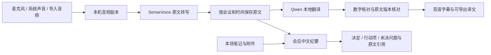

# 多语言实时翻译与模型体系

适用实现：0.6.0 / build 17，2026-10-16。本轮重点为中文、英文、日文和韩文。

## 选择：专用语音模型，翻译与纪要共用文字模型

采用三个本地功能组，不让一个通用模型同时承担所有任务，也不为每种语言各装一个大模型。

| 职责 | 当前模型和运行方式 | 原因与边界 |
| --- | --- | --- |
| 找出讲话并转写原文 | Silero VAD + SenseVoice int8，CPU | 已有固定权重，覆盖普通话、英语、日语、韩语、粤语；输出是原文，不能直接将它当作任意语言翻译器 |
| 翻译、中文纪要与问答 | Qwen3-4B-Instruct-2507 4bit，MLX / Apple Silicon GPU | 共用一次模型加载；翻译使用目标语言提示和数字核对，纪要依据原文保留引用；文字任务串行使用模型 |
| 资料范围检索 | BGE-small-zh-v1.5，CPU | 继续保留中文资料检索；本轮未升级为通用跨语言检索，外语提问的检索召回没有质量保证 |

上述是三个模型功能组，其中语音组还包含小型 VAD 权重。模型来源、revision、文件大小和 SHA-256 没有更换，不新增大模型下载。文件准备、推理成功与内容质量分别验证。

实时语音识别与文字生成分开工作，翻译变慢时原文仍可保存。文字模型锁让翻译、纪要和问答避免并发占用同一 GPU 模型；已经等待的翻译优先于下一次普通生成，已经开始的生成不会被强行抢断。这不是硬实时调度，也不保证零积压。

“一个模型处理所有任务”可以少装部分权重，但必须同时解决连续语音、断句、翻译、长会议和引用，不能仅凭模型支持音频就推定更快或更准。本轮用户确认的四种语言在已有语音模型范围内，因此优先完成现有链路，没有额外引入 Whisper、Qwen-ASR 或云服务。若以后扩大语音输入语言，应独立比较同一批音频上的识别错误、数字、人名、首段延迟和内存，再决定是否增加模型。

## 从录音到最终纪要

1. 在会议的“语言与实时翻译”中选择讲话语言和译文语言，开启“录音时显示译文”。设置只属于这场会议。
2. 实时翻译录音优先在停顿处发布音频块：至少约 2 秒，连续讲话最多约 6 秒。之后还有语音识别、翻译与界面刷新耗时。混音为了维护两路音频时间线另有约 2 秒缓冲。普通录音仍保留原来的 10 秒音频块。
3. 原文提交成功后，翻译使用独立任务队列；译文未完成时明确显示状态，翻译失败可以单独重试。导入的长音频在完成原文转写后翻译，不能将其描述成实时文件字幕。
4. 停止录音会保存尾段并继续完成原文；“停止并整理”会等待本场待处理音频完成，再用全部可用原文、笔记与附件整理中文纪要。识别失败时先要求重试，避免把不完整原文当作完整纪要输入。
5. 最终原文就是已经保存的语音模型结果，支持人工校对。没有额外声称一次未实现的高精度会后重新识别，也没有让文字模型擅自改写原文。
6. 译文和原文一起保存在本机，导出 Markdown 包含每段时间、原文和已完成译文。纪要以原文为证据，不把机器译文再作为事实来源重复摘要。

## 数据、失败与取消

- 每段译文绑定 `meeting_id`、`segment_id`、目标语言和原文 SHA-256。校对或删除期间返回的旧译文不能发布；切换目标语言可以保留其他语言的已完成译文。
- 已删除原文不进入会议详情或导出。恢复后仍保留原位置；原文发生变化则旧译文不会显示成有效结果。
- 退出时停止自己拥有的任务。中断的翻译显示为可重试错误；原文和音频保留。转写队列保存发起时的语言，重开或切换会议不会改用其他会议的设置。
- 翻译对数字遗漏、部分数字改动和常见相对时间进行检查并最多重试一次，仍不符则拒绝保存该译文。允许 `11月` / `11월` 与 `November`、`下周五` 与 `next Friday` 这类明确的表示转换。这只能发现部分错误，不能证明翻译语义、单位、专名和日期均正确。
- 纪要正文使用中文，引用保留原语言且必须是证据中的原文子串；只在引用外规范已知星期表达。未知引用编号、非原文引文或检测到凭空增加的相对周时间，会触发一次重新生成，仍有问题则不发布该次纪要。该核对不代替内容复审。
- 译文采用目标语言本族语提示，并检查较长结果是否明显缺少目标语言文字。例如完整日语句子不应全部保持中文。检查失败会有限重试或显示错误；该启发式不证明语种及内容完全正确，短名称也不强制添加假文字。
- “停止并整理”等待期间，如本场音频失败或其他会议的失败任务堵住队首，会显示处理提示并退出等待，保留待转写音频。
- 未引入外部翻译 API、账号绑定、会议上传或遥测。参考站点的登录信息没有写入应用、代码、文档或测试数据。

## 参考站点研究：观察、推断和未知项

目标：[智能翻译](https://meeting.16ff.cn/)。通过 [REA](https://github.com/morluto/rea) 连接本任务的临时 Chrome，并实际执行登录与打开新建会议表单；未创建远端会议、未上传音频、未使用日常会议内容作为研究输入。

| 类型 | 证据与结论 |
| --- | --- |
| 实际界面观察 | 新建会议表单具有智能纪要、输入语言单选、输出语言多选、热词库和智能眼镜分发选项。登录成功的最终地址为 `/#/meeting` |
| 静态前端证据 | 发布脚本 `assets/index-1QqOgN-a.js`，2,270,331 字节，SHA-256 `84beda05783e409f5fda1700d528574a198ae5f7bd1d7f88bd6b947013571024`。REA 完成脚本解析，但语义图因规模限制仅为部分覆盖 |
| 音频传输候选 | 脚本创建 `/ws/pcm/ingest` 连接，发送包含 `sample_rate`、单声道、`s16le`、输入语言和会议标识的元数据，再传输音频。这是前端静态逻辑，未实测音频传输 |
| 字幕状态候选 | `/ws/subtitle/{meetingCode}` 订阅按语言接收字幕；处理 `targetLanguage`、`content/text`、`final`，临时字幕替换、最终字幕累积，并有心跳和重连逻辑。未将静态代码冒充实测字幕延迟 |
| 纪要任务候选 | `/v1/meeting-content/{meetingCode}/summary` 的轮询与生成时间判断，表明前端将会后纪要作为独立的异步结果处理 |
| 产品借鉴 | 知会采用语言选择、原文与译文关联、独立处理进度、会后整理；通过原生 SwiftUI 和本机服务独立实现，没有复制站点代码、图标、品牌或服务器接口 |
| 未知 | 无法仅从前端判断站点后端的 ASR、翻译、纪要模型名称、参数、部署成本、实际准确率和延迟；没有证据声称站点也用知会所选模型 |

REA 证据标识：登录 `ev_6232d6d56671b06065eb303fa79e023ac53e0fe3a79b8cffe0d71c71e7679745`；新建表单 `ev_0ba6b84a641573964ebdb734e19bfcba345cabd4c5a5435630b48bd73e1dfff1`；静态分析父证据 `ev_9c91adf2935cebf989902147dab1d01a580d1a48654e33a9d3ce850a0b7d9ab5`。原始研究材料仅保留在忽略提交的任务 `work/` 目录。

## 文档来源

- [SenseVoice 官方项目](https://github.com/QwenAudio/SenseVoice)：实际发布小模型的五种语音输入范围。
- [Qwen3-4B-Instruct-2507 模型卡](https://huggingface.co/Qwen/Qwen3-4B-Instruct-2507)：文字指令与多语言模型；本机采用固定的 MLX 4bit 版本。
- [sherpa-onnx 官方实现](https://github.com/k2-fsa/sherpa-onnx)：通过 Context7 查阅非流式识别与 VAD 组合方式。知会使用短块处理，未声称实现逐 token 的流式 ASR。
- [MLX LM](https://github.com/ml-explore/mlx-lm)：通过 Context7 查阅 `stream_generate` 和生成结束状态。

本版实际验证和限制写入 [多语言翻译验收记录](多语言翻译验收记录.md)。

## 0.7.0 增量：多个目标语言与独立大屏

0.6.0 的单目标设置升级为 `target_languages` 数组，支持中文、英文、日文、韩文多选；旧 `target_language` 映射到数组首项，历史原文及译文保留。每次音频任务保存发起时的目标列表，一次转写完成后按列表提交翻译任务，各语言状态独立。语音和文字模型分工、固定权重及离线边界不变。

大屏窗口绑定打开时的会议 ID，独立刷新只含本场最近 30 段的投屏接口；主界面切换会议不会改变这个 ID。列按片段对齐，译文逐栏更新。暂停冻结显示并使旧刷新失效，后台处理继续。窗口提供多语选择、原文开关、字号、深浅色、跟随、补译和本窗口全屏；当前未实现局域网链接。

本轮真实粤语样本发现模型擅自把“蚊”解释为港币，并在译文加入原文没有的“下周”。增加歧义币种和常见相对时间增补检查，失败有限重试，仍失败则保留原文并显示译文错误。这些检查只覆盖已知模式，人名、语义、其他币种与单位仍需人工核对。完整的新版本证据与范围见[实时翻译大屏验收记录](实时翻译大屏验收记录.md)；上文保留 0.6.0 的原始研究与验收范围。
